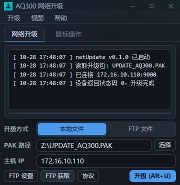

# netUpdate

netUpdate 是面向 AQ300 设备的网络升级工具。它可以把本地 PAK 文件或从 FTP
下载的升级包，通过一条 TCP 连接发送到设备，并在界面中实时显示进度和日志。

项目基于 Tauri 2、React 和 Rust，提供桌面界面，以及可脚本化的
`netupdate-cli` 命令行工具。

<p align="center">
  
</p>

## 功能

- 支持本地文件和 FTP 文件两种升级方式。
- 本地路径可以是完整 PAK 文件，也可以是目录；目录会自动拼接
  `UPDATE_AQ300.PAK`。
- 升级和可达性检查复用同一条 TCP 连接，连接失败时按配置重试。
- 实时日志、传输进度、浅色 / 深色主题和 `Alt+U` 快捷升级。
- 可在界面中调整端口、分包大小、魔数、类型、状态码偏移和超时参数。
- 附带 `netupdate-cli.exe`，支持脚本调用、`--dry-run` 预检和单行 JSON 输出。

## 快速开始

### 直接使用

从 [GitHub Releases](https://github.com/qqliyunpeng/netUpdate/releases) 下载
对应平台的安装包。Windows 安装包会在需要时引导安装 WebView2；使用便携包时，
系统需要已有 WebView2 运行时。

### 本地开发

需要 Node.js 22、pnpm 和 Rust 1.82 或更高版本，并安装对应平台的
[Tauri 开发依赖](https://v2.tauri.app/start/prerequisites/)。Windows 上还需要
WebView2。

```powershell
corepack enable
pnpm install
pnpm tauri dev
```

Windows 也可以双击 `dev.bat` 进入开发模式，或双击 `preview.bat` 只预览界面。

### 构建

```powershell
pnpm build                 # 只检查并构建前端
pnpm tauri build           # 构建桌面安装包
pnpm start                 # 按需构建并启动 release 版
pnpm portable              # 生成便携包（需先完成 tauri build）
pnpm build:cli             # 构建 netupdate-cli.exe
```

## 使用

1. 选择“本地文件”或“FTP 文件”作为升级方式。
2. 本地文件可填写完整路径或目录；FTP 模式可先打开“FTP 设置”保存服务器信息。
3. 填写设备 IP。需要时点击“协议”检查或调整传输参数。
4. 点击“升级”，或按 `Alt+U` 开始。FTP 模式可先点击“FTP 获取”下载升级包。

升级过程中会显示发送进度和设备日志。升级完成后设备可能短暂重启，这是正常现象。
程序会在连接失败时按“连接重试次数”逐次重连；每次尝试只建立一条业务连接，升级前
不会额外探测端口。

默认协议参数如下，可在“协议”窗口中修改：

| 参数 | 默认值 |
| --- | --- |
| 端口 | `9000` |
| 分包大小 | `4096` 字节 |
| 魔数 | `0x9000` |
| 包类型 | `0x0002` |
| 状态码偏移 | `32` |
| 连接超时 / 重试 | `12` 秒 / `3` 次 |
| 设备响应超时 | `120` 秒 |

“鼠标操作”页签是原工具的占位页面，实际升级功能都在“网络升级”页签。

## 命令行

`netupdate-cli.exe` 与 GUI 共用配置、FTP 下载和 TCP 升级代码，适合在批处理、
脚本和自动化工具中使用。

```powershell
pnpm build:cli
.\src-tauri\target\release\netupdate-cli.exe --help
```

以下命令假设已将 release 目录加入 `PATH`；否则请使用完整路径。

常用命令：

```powershell
netupdate-cli.exe config
netupdate-cli.exe upgrade --ip 172.16.10.110 --file Z:\UPDATE_AQ300.PAK --dry-run
netupdate-cli.exe upgrade --ip 172.16.10.110 --file Z:\UPDATE_AQ300.PAK
netupdate-cli.exe upgrade --ip 172.16.10.110 --ftp
netupdate-cli.exe download --output D:\updates
```

- 不传 `--ip`、`--file` 或 `--ftp` 时，使用 `session.json` 中的配置。
- `--ftp-host`、`--ftp-user`、`--ftp-password`、`--ftp-folder` 只影响当前调用。
- `--data-dir` 可临时覆盖配置和临时文件所在的目录。
- `--dry-run` 只检查 IP、文件是否存在和文件大小，不连接设备。
- 实际升级成功返回 `0`，失败返回 `1`。

需要在脚本中解析结果时，使用全局 `--json` 参数。完整结果输出到 stdout，日志和进度
输出到 stderr：

```powershell
$result = netupdate-cli.exe --json upgrade `
  --ip 172.16.10.110 --file Z:\UPDATE_AQ300.PAK --dry-run | ConvertFrom-Json
if ($LASTEXITCODE -ne 0 -or -not $result.ok) { throw $result.error }
```

为避免密码出现在命令历史和日志中，建议通过环境变量传入 FTP 密码：

```powershell
$env:NETUPDATE_FTP_PASSWORD = 'your-password'
netupdate-cli.exe --json download --output D:\updates
```

## 配置与数据

配置保存在各平台的应用数据目录中。Windows 下的位置是：

```text
%APPDATA%\com.localtools.netupdate\session.json
%APPDATA%\com.localtools.netupdate\tmp\UPDATE_AQ300.PAK
```

`session.json` 保存升级方式、路径、设备 IP、FTP 设置、协议参数、主题和窗口位置。
首次启动时若没有该文件，程序会尝试从可执行文件目录或当前目录的旧版 `config.ini`
导入配置。

FTP 密码和旧版工具一样以明文保存在本地配置中。请只在受控环境中使用，并妥善限制
配置文件的访问权限。

## 项目结构

```text
src/                      React 界面和 Tauri 前端桥接
src-tauri/src/            Rust 后端、升级协议、FTP、配置和 CLI
src-tauri/tauri.conf.json 窗口、打包和安装配置
scripts/                  开发启动、链接器修复和便携包脚本
docs/images/              README 图片
```

## 说明

- `pnpm dev` 只启动浏览器预览，不会连接 FTP 或升级设备；完整功能请使用
  `pnpm tauri dev` 或 release 版。
- 本仓库中的 `.bat` 和 `.ps1` 启动脚本面向 Windows；桌面程序本身由 CI 同时构建
  Windows、Linux 和 macOS 版本。
- 如需修改代码或让自动化代理参与开发，请先阅读 `AGENTS.md`。
